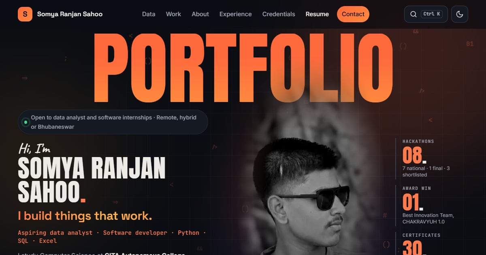

# Somya Ranjan Sahoo

**Data analyst in the making and software developer from Bhubaneswar, Odisha.**
I turn messy data into clear answers, and I build things that work.

## About me

- B.Tech in Computer Science & Engineering at GITA Autonomous College, Bhubaneswar (2025 to 2029)
- Seven years at Sainik School Bhubaneswar, with NCC training in the Navy and Army wings
- Back-End / Python Developer Intern at The Entrepreneurship Network, with a letter of recommendation from the Director
- Best Innovation Team at CHAKRAVYUH 1.0 National Hackathon, and a national finalist at India Innovates 2026 with my team, ASTRA-X
- Working with Python, SQL, Excel and pandas, and building with FastAPI, Streamlit and Three.js

## What you'll find on the site

| Section | What's there |
|---|---|
| **Data lab** | An analysis of 2,003 Indian toll plazas, an Excel dashboard, and a live SQL database you can query in your browser |
| **Projects** | Case studies of VANTAGE: ZERO, GOD VIEW, UNSPOKEN, ANUMATI, the Smart Toll Plaza system and more |
| **Experience and education** | Internships, school and college, with certificates you can open full size |
| **Credentials** | 30 certificates and 12 awards and badges, 13 of them verifiable on Coursera |
| **Resume** | Two one-page versions to download |
| **Ask me anything** | A small chat that answers questions about my work |
| **Contact** | A form that reaches my inbox |

## Website analytics

Measured with Google PageSpeed Insights on 7 November 2026. Google tests mobile on a simulated budget phone over slow 4G.

| | Performance | Accessibility | Best Practices | SEO |
|---|---|---|---|---|
| **Mobile** | 96–100 | 100 | 100 | 100 |
| **Desktop** | 100 | 100 | 100 | 100 |

- **Speed on a phone:** the first screen appears in about 1 second and the main image in about 2.4 seconds on Google's slow-4G test. Repeat visits load from the device and appear about twice as fast.
- **Weight:** about 190 KB for the first screen, with fonts trimmed to the characters the site uses.
- **Search:** indexed on Google and Bing, with structured data marking it as my profile page.
- **Privacy:** no tracking cookies, no ad scripts and no analytics trackers.
- **Built with:** plain HTML, CSS and JavaScript, hosted on GitHub Pages.

## Contact

Send a message through the [contact form](https://somyaranjansahoo6422.github.io/#contact), or connect on [LinkedIn](https://www.linkedin.com/in/somya-ranjan-sahoo-109599312/).

## License

The code is under the [MIT license](LICENSE). Photos, certificates, resume files and other personal content belong to Somya Ranjan Sahoo and the people shown, and may not be reused without permission.
